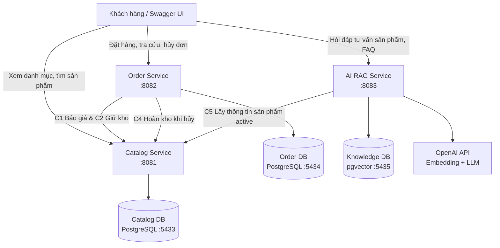

# Đồ án BTL: Hệ thống Thương mại Điện tử Bán lẻ Microservices + Quarkus + AI RAG

> **Đề tài:** Nghiên cứu và phát triển ứng dụng thương mại điện tử bán lẻ với kiến trúc Microservices, ứng dụng framework Quarkus và tích hợp trợ lý AI bằng mô hình RAG (Retrieval-Augmented Generation).
> 
> **Kiến trúc:** 3 microservices độc lập viết bằng **Quarkus (Java 21)**, chạy với **3 database PostgreSQL độc lập** và **Docker Compose**. Trao đổi dữ liệu qua REST API theo chuẩn **Contract V1.0**.

---

## 1. Phân công trách nhiệm & Cấu trúc hệ thống

Dựa trên tài liệu định hướng kiến trúc `DINH_HUONG_THIET_KE_HE_THONG_MVP.md`:

```
BTL/
├── catalog-service/        # Thành viên A: Quản lý danh mục, sản phẩm, tồn kho & báo giá
├── order-service/          # Thành viên B: Quản lý đơn hàng, guest checkout & xử lý hoàn kho
├── ai-rag-service/         # Thành viên C: Trợ lý AI RAG giải đáp FAQ & tri thức sản phẩm
├── compose.yaml            # Docker Compose điều phối toàn bộ 6 container (3 DB + 3 App)
├── .env.example            # Mẫu biến môi trường dùng chung
└── .github/workflows/      # CI/CD tự động kiểm thử và đóng gói cho từng service
```

| Thành viên | Service đảm nhiệm | Database & Port | Nhiệm vụ chính & Hợp đồng sở hữu | Trạng thái |
|---|---|---|---|---|
| **A — Catalog** | `catalog-service` | `catalog_db`<br>Host: `:8081` / DB: `:5433` | Quản lý danh mục, sách, báo giá (C1), giữ kho idempotent (C2), xem giữ kho (C3), hoàn kho (C4), xuất feed sản phẩm cho AI (C5). | **Hoàn thành** (Đã merge, có CI) |
| **B — Order** | `order-service` | `order_db`<br>Host: `:8082` / DB: `:5434` | Guest checkout (P1), tra cứu đơn (P2), hủy đơn (P3), gọi C1/C2/C4 sang Catalog, reconciliation job retry khi timeout. | **Đang hoàn thiện** |
| **C — AI RAG** | `ai-rag-service` | `knowledge_db` (pgvector)<br>Host: `:8083` / DB: `:5435` | Quản lý FAQ (A2), import sản phẩm active qua C5, chunking, pgvector 1536d (A3), semantic search top-4, sinh câu trả lời có trích dẫn nguồn (A1). | **Hoàn thành** (23 tests PASS, có CI) |

---

## 2. Kiến trúc tổng quan & Luồng tích hợp



---

## 3. Bảng tổng hợp API Contracts (Contract V1.0)

Mọi API phản hồi đều kèm header `X-Request-Id`. Lỗi chuẩn hóa: `{"error": {"code": "...", "message": "...", "requestId": "..."}}`.

### A. Catalog Service (`:8081`)
- **Public:** `GET /api/categories`, `GET /api/products` (tìm kiếm, lọc, phân trang).
- **Admin (`X-Admin-Key`):** CRUD danh mục, CRUD sản phẩm, cập nhật tồn kho.
- **Internal (`X-Internal-Key`):**
  - **C1:** `POST /internal/catalog/quote` — Báo giá cho giỏ hàng.
  - **C2:** `POST /internal/stock/reservations` — Giữ kho theo `orderId` (idempotent, khóa bi quan).
  - **C3:** `GET /internal/stock/reservations/{orderId}` — Tra cứu trạng thái giữ kho.
  - **C4:** `POST /internal/stock/reservations/{orderId}/release` — Hoàn kho khi hủy đơn.
  - **C5:** `GET /internal/ai/products?offset=0&limit=50` — Cung cấp dữ liệu sản phẩm active cho AI RAG.

### B. Order Service (`:8082`)
- **Public (Xác thực bằng `X-Checkout-Key` ngẫu nhiên cho mỗi đơn):**
  - **P1:** `POST /api/orders` — Tạo đơn hàng mới (gọi C1 lấy giá -> lưu PENDING -> gọi C2 giữ kho -> CONFIRMED).
  - **P2:** `GET /api/orders/{id}` — Tra cứu trạng thái đơn hàng.
  - **P3:** `POST /api/orders/{id}/cancel` — Hủy đơn đã xác nhận (gọi C4 hoàn kho -> CANCELLED).

### C. AI RAG Service (`:8083`)
- **Public:**
  - **A1:** `POST /api/chat` — Trợ lý RAG tư vấn (vector search top-4, sinh câu trả lời kèm nguồn `FAQ`/`PRODUCT`, từ chối câu hỏi giá/tồn kho realtime hoặc thiếu ngữ cảnh).
  - `GET /api/ping` & `GET /q/health` — Kiểm tra liveness và readiness.
- **Admin (`X-Admin-Key`):**
  - **A2:** `POST /api/admin/knowledge/documents` — Quản lý tài liệu FAQ và chính sách.
  - **A3:** `POST /api/admin/knowledge/reindex` — Kích hoạt quét C5 Catalog và tái lập chỉ mục vector pgvector.

---

## 4. Hướng dẫn khởi chạy toàn bộ hệ thống bằng Docker Compose

### Bước 1: Thiết lập cấu hình
```powershell
# Tạo file biến môi trường từ mẫu
Copy-Item .env.example .env

# Sửa các secret và điền OPENAI_API_KEY
notepad .env
```

### Bước 2: Đóng gói các service
```powershell
# 1. Catalog Service
cd catalog-service; .\mvnw.cmd clean package -DskipTests; cd ..

# 2. AI RAG Service
cd ai-rag-service; .\mvnw.cmd clean package -DskipTests; cd ..

# 3. Order Service (khi hoàn thành)
# cd order-service; .\mvnw.cmd clean package -DskipTests; cd ..
```

### Bước 3: Khởi chạy 6 containers
```powershell
docker compose up -d --build
docker compose ps
```

Kiểm tra trạng thái sẵn sàng của các service:
- Catalog Health: `Invoke-RestMethod http://localhost:8081/q/health`
- Order Health: `Invoke-RestMethod http://localhost:8082/q/health`
- AI RAG Health: `Invoke-RestMethod http://localhost:8083/q/health`

---

## 5. Kiểm thử độc lập từng service

Mỗi service đều có thể chạy và kiểm thử độc lập mà không cần chờ các service khác:
- **`catalog-service`:** Xem chi tiết tại [catalog-service/README.md](file:///D:/University/5/HDV/BTL/catalog-service/README.md) (`.\mvnw.cmd test`).
- **`ai-rag-service`:** Xem chi tiết tại [ai-rag-service/README.md](file:///D:/University/5/HDV/BTL/ai-rag-service/README.md) (`.\mvnw.cmd test` - 23 unit tests).
