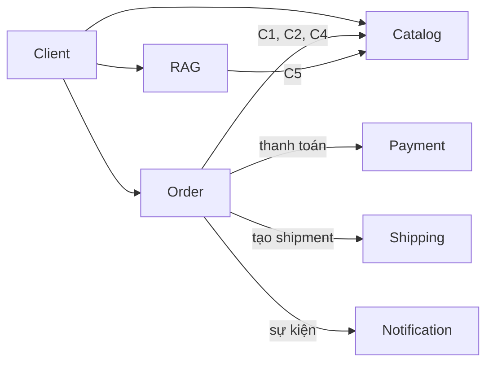

# Hệ thống thương mại điện tử bán lẻ Microservices

Hệ thống gồm sáu microservice Quarkus Java 21 với database PostgreSQL tách biệt.
Mỗi service sở hữu dữ liệu của mình và chỉ giao tiếp qua REST API.

## Kiến trúc

| Service | Cổng | Database | Trách nhiệm |
|---|---:|---|---|
| `catalog-service` | 8081 | `catalog_db` / 5433 | Danh mục, sản phẩm, giá và tồn kho. |
| `order-service` | 8082 | `order_db` / 5434 | Guest checkout và điều phối vòng đời đơn hàng. |
| `ai-rag-service` | 8083 | `knowledge_db` / 5435 | Hỏi đáp RAG từ FAQ và feed sản phẩm. |
| `payment-service` | 8084 | `payment_db` / 5436 | Thanh toán mô phỏng, idempotent theo đơn hàng. |
| `shipping-service` | 8085 | `shipping_db` / 5437 | Shipment và trạng thái giao hàng. |
| `notification-service` | 8086 | `notification_db` / 5438 | Lưu thông báo mô phỏng theo sự kiện đơn hàng. |

`catalog-service` cũng là Product Service của hệ thống.
Nó sở hữu sản phẩm, giá và tồn kho nên không có một `product-service` trùng lặp.



## Vòng đời đơn hàng

1. `POST /api/orders` gửi email, địa chỉ giao hàng và các dòng hàng.
2. Order lấy báo giá C1, lưu snapshot giá, gọi C2 giữ kho và chuyển đơn sang `CONFIRMED`.
3. `POST /api/orders/{id}/pay` với `X-Checkout-Key` tạo payment idempotent.
4. Payment được ủy quyền thì Order chuyển đơn sang `PAID`, tạo shipment và ghi notification.
5. `POST /api/orders/{id}/cancel` hoàn kho C4.
   Nếu đơn đã thanh toán, Order chỉ hủy khi shipment còn `CREATED`, sau đó hoàn tiền.

Các service nội bộ dùng `X-Internal-Key`.
Mọi response đều trả lại `X-Request-Id`.
`X-Checkout-Key` là capability bí mật của một guest order và chỉ dùng để xem, thanh toán hoặc hủy đúng đơn đó.

## API chính

| Service | API |
|---|---|
| Catalog | C1 `POST /internal/catalog/quote`; C2/C3/C4 `/internal/stock/reservations`; C5 `GET /internal/ai/products`. |
| Order | `POST /api/orders`; `GET /api/orders/{id}`; `POST /api/orders/{id}/pay`; `POST /api/orders/{id}/cancel`. |
| Payment | `POST /internal/payments`; `GET /internal/payments/{orderId}`; `POST /internal/payments/{orderId}/refund`. |
| Shipping | `POST /internal/shipments`; `GET /internal/shipments/{orderId}`; `POST /internal/shipments/{orderId}/cancel`. |
| Notification | `POST /internal/notifications`; `GET /internal/notifications/{orderId}`. |
| AI RAG | `POST /api/chat`; `POST /api/admin/knowledge/documents`; `POST /api/admin/knowledge/reindex`. |

Payment, shipment và notification là mô phỏng có trạng thái bền vững trong database.
Chúng không gọi cổng thanh toán, hãng vận chuyển hoặc SMTP thật.

## Chạy bằng Docker Compose

```powershell
Copy-Item .env.example .env
# Điền password database, INTERNAL_API_KEY, ADMIN_API_KEY và GEMINI_API_KEY.
docker compose up -d --build
docker compose ps
```

Kiểm tra health tại `http://localhost:8081/q/health` đến `http://localhost:8086/q/health`.
Compose tự build image từ thư mục service, vì vậy cần package các module trước:

```powershell
.\catalog-service\mvnw.cmd -f .\order-service\pom.xml -DskipTests package
.\catalog-service\mvnw.cmd -f .\payment-service\pom.xml -DskipTests package
.\catalog-service\mvnw.cmd -f .\shipping-service\pom.xml -DskipTests package
.\catalog-service\mvnw.cmd -f .\notification-service\pom.xml -DskipTests package
```

Maven Wrapper có sẵn tại `catalog-service` và dùng chung phiên bản Quarkus cho các module mới.
